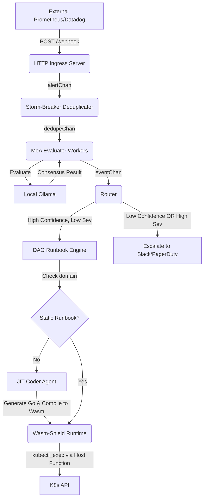

# Reflex 🚀✨

> [!WARNING]
> **Experimental / Work In Progress**
> This repository is a sandbox for an Intelligent Observability and Remediation Proxy. It is not currently intended for production use.

**Intelligent Observability and Remediation Proxy**

Reflex is a high-throughput Go proxy that ingests infrastructure alerts via HTTP webhooks, evaluates them concurrently using local AI (Ollama), and routes them to either an auto-remediation runbook or a human escalation queue.

## 🌟 Core Features

1. **Wasm-Shield**: Secure WebAssembly runbook execution via `wazero` with strict Open Policy Agent (OPA) host-call authorization.
2. **MoA Evaluator**: Mixture-of-Agents consensus to prevent LLM hallucinations.
3. **Storm-Breaker**: Sliding-window deduplicator squashing "Thundering Herd" alert storms using RAG embeddings.
4. **JIT Coder Agent**: On-the-fly autonomous Go WebAssembly generation. When Reflex encounters a failing domain it doesn't have a static runbook for, it dynamically writes, compiles, and executes a Wasm runbook using local LLMs.
5. **Environment-Aware HITL (Human-in-the-Loop)**: Production environments require explicit human approval (`reflex approve`) before execution. Staging environments auto-execute for rapid chaos testing.
6. **Stateful DAGs**: Runbooks execute as LIFO state-machines with automatic compensation rollbacks.
7. **Kubernetes Checkpointing**: Distributed checkpointing and Orphan Watcher for stateless crash-recovery via K8s ConfigMaps.

## 🏗️ Architecture

We use standard Go concurrency (goroutines and buffered channels) to keep things completely non-blocking and prevent deadlocks during high-traffic bursts.



## 📖 Configuration (`runbooks.yaml` & `reflex.yaml`)

Reflex maps failing components to stateful execution DAGs via `runbooks.yaml`. 
You can provide **local scripts**, or dynamically fetch Wasm runbooks directly from a **Remote Registry (HTTP)**.

```yaml
runbooks:
  database:
    steps:
      - name: "Restart DB"
        action: "./scripts/restart-redis.wasm"
        compensate: "./scripts/rollback-redis.wasm"
```

If a domain (e.g., `network`) is NOT mapped, the **JIT Coder Agent** will generate one on the fly.

**Environment variables (`reflex.yaml`) control HITL:**
- `REFLEX_ENV=staging`: JIT runbooks auto-execute.
- `REFLEX_ENV=production`: Runbooks pause for human approval.

## 🧪 End-to-End Local Testing
Want to test the full auto-remediation pipeline with a real local Kubernetes cluster?
Check out the **[End-to-End Kubernetes Testing Guide](TESTING.md)** for detailed instructions on spinning up the cluster and verifying runbooks locally.
