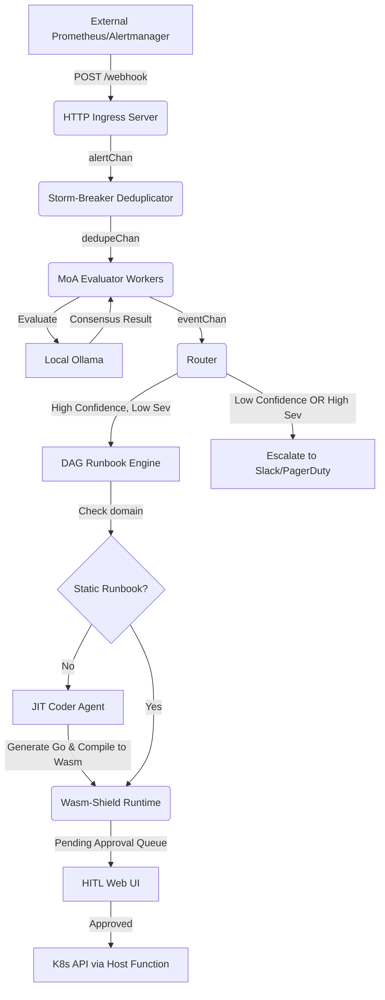

# Reflex 🚀✨

> [!WARNING]
> **Experimental / Work In Progress**
> This repository is a sandbox for an Intelligent Observability and Remediation Proxy. It is not currently intended for production use.

**Intelligent Observability and Remediation Proxy**

Reflex is a high-throughput Go proxy that ingests infrastructure alerts via HTTP webhooks, evaluates them concurrently using local AI (Ollama), and routes them to either an auto-remediation runbook or a human escalation queue.

## 🎬 Live Interactive Demo

Reflex pairs autonomous AI reasoning with an enterprise **Human-in-the-Loop (HITL)** dashboard and strict **Kubernetes Cluster Checkpointing**.

### 1. Web UI Operator Flow (Diffs, Pod Logs, & 1-Click Rollback)
Review proposed cluster mutations before execution. Inspect unified Git-style diffs (`+`/`-`), stream live failing pod stdout/stderr, verify K8s events, and execute 1-click compensation rollbacks.


### 2. Kubernetes Cluster Remediation Pipeline
From Prometheus Alertmanager webhook ingress to Wazero WebAssembly sandbox execution and distributed ConfigMap checkpointing.


## 🌟 Core Features

1. **Wasm-Shield**: Secure WebAssembly runbook execution via `wazero` with strict Open Policy Agent (OPA) host-call authorization.
2. **MoA Evaluator**: Mixture-of-Agents consensus to prevent LLM hallucinations.
3. **Storm-Breaker**: Sliding-window deduplicator squashing "Thundering Herd" alert storms across microservice fleets using RAG embeddings.
4. **JIT Coder Agent**: On-the-fly autonomous Go WebAssembly generation. When Reflex encounters a failing domain it doesn't have a static runbook for, it dynamically writes, compiles, and executes a Wasm runbook using local LLMs.
5. **Environment-Aware HITL (Human-in-the-Loop)**: Production environments require explicit human approval via the embedded `/ui/` dashboard displaying unified cluster state diffs and pod logs. Staging environments auto-execute for rapid chaos testing.
6. **Stateful DAGs & LIFO Compensation**: Runbooks execute as state-machines with automatic inverse compensation rollbacks (`./scripts/rollback-*.wasm`).
7. **Kubernetes Checkpointing**: Distributed checkpointing and Orphan Watcher for stateless crash-recovery via K8s ConfigMaps.

## 🏗️ Architecture

We use standard Go concurrency (goroutines and buffered channels) to keep things completely non-blocking and prevent deadlocks during high-traffic bursts.



## 📖 Configuration (`runbooks.yaml` & `reflex.yaml`)

Reflex maps failing components to stateful execution DAGs via `runbooks.yaml`. 
You can provide **local scripts**, or dynamically fetch Wasm runbooks directly from a **Remote Registry (HTTP)**.

```yaml
runbooks:
  database:
    steps:
      - name: "Restart DB"
        action: "./scripts/restart-redis.wasm"
        compensate: "./scripts/rollback-redis.wasm"
```

If a domain (e.g., `network`) is NOT mapped, the **JIT Coder Agent** will generate one on the fly.

**Environment variables (`reflex.yaml`) control HITL:**
- `REFLEX_ENV=staging`: Auto-execute all runbooks instantly.
- `REFLEX_ENV=production`: Runbooks pause in the pending queue for manual human approval via the Web UI (`http://localhost:8080/ui/`).

### 🛡️ SRE Architecture Note: Pod Scaling vs. Connection Draining

A critical distinction in production reliability engineering:
- **Scaling Pods to 0 (`kubectl scale --replicas=0`)**: Changes desired replica count. Kubernetes terminates the pod immediately. Active TCP sockets receive `ECONNRESET`, in-flight requests abort, and datastores (like Redis) experience a hard outage. In Reflex's local sandbox, this was initially used as a fast demonstration of host-level mutations.
- **True Connection Draining**: Allows in-flight queries/requests to finish while cleanly redirecting new traffic:
  - **Stateless Services (`sample-app`, `order-service`)**: Rolling restarts (`kubectl rollout restart deploy/<name>`) or EndpointSlice traffic shedding ensure zero downtime while draining active HTTP keep-alive connections.
  - **Stateful Datastores (Redis)**: Application-level draining requires protocol commands (`CLIENT PAUSE <ms>` or `CLIENT KILL TYPE normal`) or Sentinel/Cluster failover before graceful pod restarts with `preStop` flush hooks.

Reflex runbooks enforce rolling updates and health probes across the microservice fleet to ensure zero dropped client traffic.

## 📟 Integrations
- **Alertmanager Ingestion:** The `/webhook` endpoint natively supports the Prometheus/Alertmanager array payload format, meaning no translation proxy is required between your Alertmanager receivers and Reflex.
- **Slack/PagerDuty Escalations:** When the MoA Engine generates a low-confidence decision or evaluates a highly severe unrecoverable alert, it instantly fires a Slack-compatible JSON webhook payload alerting human operators for manual intervention.

## 🧪 End-to-End Local Testing
Want to test the full auto-remediation pipeline with a real local Kubernetes cluster?
Check out the **[End-to-End Kubernetes Testing Guide](TESTING.md)** for detailed instructions on spinning up the cluster and verifying runbooks locally.
